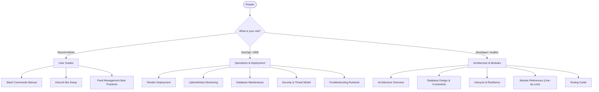

# RSS Discord Bot Documentation

Welcome to the technical documentation for **RSS Discord Bot**, a lightweight, resilient, self-hosted RSS and Atom feed distribution system built with **Bun**, **TypeScript**, **discord.js**, and **PostgreSQL**.

This documentation suite provides an exhaustive reference for system architects, developers, site reliability engineers (SREs), and Discord server administrators.

---

## 🧭 Navigation by Role



### 1. System Architecture & Design
High-level design principles, component topology, data flows, database schemas, and process lifecycles.
- [Architecture Overview](file:///home/afnan/Projects/rss-bot/docs/architecture/overview.md) — System boundaries, event topology, and runtime interactions.
- [Database Design & Schemas](file:///home/afnan/Projects/rss-bot/docs/architecture/database-design.md) — Tables, unique constraints, relational cascading, indexes, and duplicate elimination.
- [Lifecycle & Resilience](file:///home/afnan/Projects/rss-bot/docs/architecture/lifecycle-and-resilience.md) — Startup bootstrap, polling event loop, graceful shutdown, and Render free-tier sleep mitigation.

### 2. Module Technical References ("Down to Every Line")
Deep technical documentation of every file, function, algorithm, type definition, and regex pattern.
- [Configuration Reference](file:///home/afnan/Projects/rss-bot/docs/modules/configuration.md) — Zod schema validation, environment variables, coercion rules (`src/config.ts`).
- [Database Layer & Repositories](file:///home/afnan/Projects/rss-bot/docs/modules/database-layer.md) — Postgres client pooling, SSL, and all 4 repository modules (`src/db/`).
- [Network & SSRF Defense](file:///home/afnan/Projects/rss-bot/docs/modules/network-and-ssrf.md) — Conditional HTTP caching (ETag/304), timeout handling, and IP/DNS SSRF filtering (`src/rss/fetcher.ts`).
- [Feed Parser Engine](file:///home/afnan/Projects/rss-bot/docs/modules/feed-parser.md) — Fast-XML-Parser, HTML stripping, entity decoding, image extraction, and deterministic item hashing (`src/rss/parser.ts`).
- [Polling Engine](file:///home/afnan/Projects/rss-bot/docs/modules/polling-engine.md) — Concurrent scheduling loop, pacing, and exponential backoff calculations (`src/rss/poller.ts`).
- [Publishing Service](file:///home/afnan/Projects/rss-bot/docs/modules/publishing-service.md) — Embed builders, channel/thread routing, and auto-unarchiving (`src/services/publisher.ts`).
- [Subscription Service](file:///home/afnan/Projects/rss-bot/docs/modules/subscription-service.md) — Feed subscription workflows, duplicate guards, and baseline establishment (`src/services/subscriptions.ts`).
- [Discord Bot Client & Handlers](file:///home/afnan/Projects/rss-bot/docs/modules/discord-bot.md) — Gateway events, REST registration, command schemas, and interaction handlers (`src/bot/`).
- [HTTP Health Server](file:///home/afnan/Projects/rss-bot/docs/modules/health-server.md) — Bun HTTP server, `/health`, `/ready`, `/ping` endpoints, and Discord WebSocket status mapping (`src/http/health.ts`).

### 3. User & Administrator Guides
Practical manuals for configuring the bot in Discord and managing subscriptions.
- [Slash Commands Guide](file:///home/afnan/Projects/rss-bot/docs/user-guide/slash-commands.md) — All 8 `/rss` commands, parameter types, permissions, and responses.
- [Discord Setup Guide](file:///home/afnan/Projects/rss-bot/docs/user-guide/discord-setup.md) — Discord Developer Portal setup, OAuth2 URL generator, bot permissions, and intents.
- [Feed Management Best Practices](file:///home/afnan/Projects/rss-bot/docs/user-guide/feed-management.md) — Dedicated threads vs text channels, polling intervals, and baseline mechanics.

### 4. Operations & SRE Runbooks
Deployment procedures, monitoring configurations, database tuning, and incident resolution.
- [Render Deployment Guide](file:///home/afnan/Projects/rss-bot/docs/operations/deployment-render.md) — Docker container build, environment variables, and `render.yaml` deployment.
- [UptimeRobot Monitoring](file:///home/afnan/Projects/rss-bot/docs/operations/monitoring-uptimerobot.md) — Setting up 5-minute health pings to keep the free-tier service awake.
- [Database Maintenance](file:///home/afnan/Projects/rss-bot/docs/operations/database-maintenance.md) — Supabase / Neon connection pooler settings, backup strategies, and row retention.
- [Security & Threat Model](file:///home/afnan/Projects/rss-bot/docs/operations/security-and-threat-model.md) — Server-Side Request Forgery (SSRF) attack vectors, network filtering, and permission boundaries.
- [Troubleshooting Runbook](file:///home/afnan/Projects/rss-bot/docs/operations/troubleshooting.md) — Root-cause analysis and remediation for common errors, rate limits, and permission issues.

### 5. Reference & Standards
- [Standards & Glossary](file:///home/afnan/Projects/rss-bot/docs/reference/glossary.md) — RSS 2.0, Atom 1.0, RFC 1918, RFC 7232, and Discord API terminology.
- [Testing Guide](file:///home/afnan/Projects/rss-bot/docs/reference/testing-guide.md) — Bun test suite execution, unit test structures, mocks, and coverage criteria.

---

## 📊 Core Feature Matrix

| Feature | Implementation | Key Benefits |
| :--- | :--- | :--- |
| **Stateless Execution** | PostgreSQL-backed cursors (`feed_state`) | Zero state loss during cold boots, crashes, or rolling updates. |
| **Duplicate Prevention** | `(subscription_id, item_key)` DB constraint | Immune to feed reordering, GUID mutations, or partial fetch retries. |
| **Zero-Spam Baseline** | Historical items pre-indexed with `posted_at = NOW()` | Prevents spamming hundreds of historical posts when adding a new feed. |
| **SSRF Protection** | DNS resolution & IP blocklists | Neutralizes attacks targeting cloud metadata (`169.254.169.254`) and internal networks. |
| **Conditional Requests** | HTTP `If-None-Match` & `If-Modified-Since` | Minimizes CPU, bandwidth, and origin server load via `304 Not Modified`. |
| **Dedicated Threads** | Discord auto-thread creation & unarchiving | Keeps main channels clean while preserving discussion context. |
| **Dual Permissions** | API metadata (`setDefaultMemberPermissions`) + Runtime checks | Ensures only authorized server managers can execute administrative commands. |
| **Liveness Probes** | Native Bun HTTP server with `/health` | Integrates with Render and UptimeRobot to ensure 24/7 continuous operation. |

---

## ⚡ Quick Start

```bash
# 1. Clone repository & install dependencies
git clone https://github.com/HyperAfnan/rss-bot.git
cd rss-bot
bun install

# 2. Configure environment
cp .env.example .env
# Edit .env with your DATABASE_URL, DISCORD_TOKEN, and DISCORD_CLIENT_ID

# 3. Verify types and run test suite
bun run typecheck
bun test

# 4. Start in development mode (hot reloading)
bun run dev

# 5. Production launch
bun run start
```
