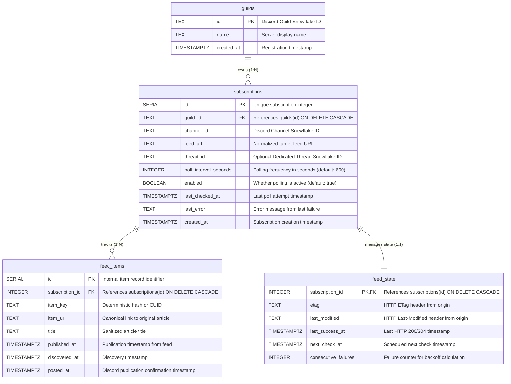

# Database Design & Relational Schema

The persistence layer for the RSS Discord Bot is implemented in **PostgreSQL**. State is intentionally excluded from the application memory space so that the bot remains completely stateless and resilient across server restarts, container redeployments, or crash recoveries.

The schema definition is maintained in [`src/db/schema.sql`](file:///home/afnan/Projects/rss-bot/src/db/schema.sql) and executed automatically upon startup via [`initDatabase()`](file:///home/afnan/Projects/rss-bot/src/db/client.ts#L42-L52).

---

## 🗄️ Entity-Relationship Diagram



---

## 📋 Table Specifications & Column Reference

### 1. `guilds`
Stores Discord servers that have interacted with the bot.

| Column | Type | Constraints | Description |
| :--- | :--- | :--- | :--- |
| `id` | `TEXT` | `PRIMARY KEY` | Discord Snowflake ID of the guild (e.g. `"123456789012345678"`). |
| `name` | `TEXT` | `NOT NULL` | Discord server name at time of last command execution. |
| `created_at` | `TIMESTAMPTZ` | `NOT NULL DEFAULT NOW()` | Record insertion timestamp. |

* **Upsert Behavior**: Updated automatically during `/rss add` via [`upsertGuild`](file:///home/afnan/Projects/rss-bot/src/db/repositories/guilds.ts#L9-L22) to keep guild names current.

---

### 2. `subscriptions`
Maintains user-configured RSS feed subscriptions per channel.

| Column | Type | Constraints | Description |
| :--- | :--- | :--- | :--- |
| `id` | `SERIAL` | `PRIMARY KEY` | Incremental integer identifying the subscription in user commands (`#1`, `#2`). |
| `guild_id` | `TEXT` | `NOT NULL REFERENCES guilds(id) ON DELETE CASCADE` | Guild owning this subscription. |
| `channel_id` | `TEXT` | `NOT NULL` | Discord Channel Snowflake where updates or threads are created. |
| `feed_url` | `TEXT` | `NOT NULL` | Validated target feed URL. |
| `thread_id` | `TEXT` | `NULLABLE` | Discord Thread Snowflake ID if updates are routed to a dedicated thread. |
| `poll_interval_seconds`| `INTEGER` | `NOT NULL DEFAULT 600` | Polling interval (configured via `/rss add interval:`, minimum 60s). |
| `enabled` | `BOOLEAN` | `NOT NULL DEFAULT TRUE` | Active polling toggle. Toggled by `/rss pause` and `/rss resume`. |
| `last_checked_at` | `TIMESTAMPTZ` | `NULLABLE` | Timestamp of the most recent fetch attempt. |
| `last_error` | `TEXT` | `NULLABLE` | Error message string if the most recent fetch attempt threw an error. |
| `created_at` | `TIMESTAMPTZ` | `NOT NULL DEFAULT NOW()` | Timestamp when subscription was created. |

#### Constraints:
- **`CONSTRAINT uq_channel_feed UNIQUE (channel_id, feed_url)`**: Prevents the same channel from subscribing to the exact same feed twice. Enforced at the database level and caught gracefully in [`addSubscription()`](file:///home/afnan/Projects/rss-bot/src/services/subscriptions.ts#L63-L66).

---

### 3. `feed_items`
Tracks individual articles parsed from feeds to guarantee duplicate elimination.

| Column | Type | Constraints | Description |
| :--- | :--- | :--- | :--- |
| `id` | `SERIAL` | `PRIMARY KEY` | Unique internal entry identifier. |
| `subscription_id` | `INTEGER` | `NOT NULL REFERENCES subscriptions(id) ON DELETE CASCADE` | Owning subscription reference. |
| `item_key` | `TEXT` | `NOT NULL` | Normalized unique identifier (GUID, URL, or SHA-256 hash). |
| `item_url` | `TEXT` | `NULLABLE` | Hyperlink to the full web article. |
| `title` | `TEXT` | `NULLABLE` | Sanitized plaintext article title. |
| `published_at` | `TIMESTAMPTZ` | `NULLABLE` | Parsed date from `<pubDate>`, `<dc:date>`, or `<updated>`. |
| `discovered_at` | `TIMESTAMPTZ` | `NOT NULL DEFAULT NOW()` | Timestamp when the poller first encountered this item. |
| `posted_at` | `TIMESTAMPTZ` | `NULLABLE` | Timestamp when Discord confirmed delivery. If `NULL`, item was discovered but not yet posted. |

#### Constraints & Deduplication Logic:
- **`CONSTRAINT uq_subscription_item UNIQUE (subscription_id, item_key)`**: Guarantees that within a given subscription, the exact same article cannot be stored or published multiple times.
- **Two-Phase Publication State**:
  1. Discovery: Item inserted with `posted_at = NULL`.
  2. Delivery: Message dispatched to Discord.
  3. Confirmation: `posted_at` updated to `NOW()`. If the bot crashes between steps 1 and 2, subsequent runs identify unposted items using `getUnpostedItems()`.

---

### 4. `feed_state`
Decouples volatile polling and HTTP caching metadata from core subscription configurations.

| Column | Type | Constraints | Description |
| :--- | :--- | :--- | :--- |
| `subscription_id` | `INTEGER` | `PRIMARY KEY REFERENCES subscriptions(id) ON DELETE CASCADE` | 1:1 foreign key binding to `subscriptions`. |
| `etag` | `TEXT` | `NULLABLE` | HTTP `ETag` string returned by the origin server for `If-None-Match`. |
| `last_modified` | `TEXT` | `NULLABLE` | HTTP `Last-Modified` string returned by the origin server for `If-Modified-Since`. |
| `last_success_at` | `TIMESTAMPTZ` | `NULLABLE` | Timestamp of last HTTP 200 or 304 response. |
| `next_check_at` | `TIMESTAMPTZ` | `NOT NULL DEFAULT NOW()` | Timestamp when this feed is eligible for polling. Used by scheduler index. |
| `consecutive_failures`| `INTEGER` | `NOT NULL DEFAULT 0` | Consecutive error count, used to calculate exponential backoff. |

---

## ⚡ Indexing Strategy

The schema includes targeted B-tree indexes designed for low-latency queries during high-frequency polling:

```sql
-- Fast lookup of all feeds owned by a guild (used by /rss list and /rss status)
CREATE INDEX IF NOT EXISTS idx_subscriptions_guild ON subscriptions(guild_id);

-- Filter active subscriptions during poll cycles
CREATE INDEX IF NOT EXISTS idx_subscriptions_enabled ON subscriptions(enabled);

-- Fast lookup when validating or managing dedicated threads
CREATE INDEX IF NOT EXISTS idx_subscriptions_thread ON subscriptions(thread_id);

-- Critical polling index: Enables O(log N) lookup of due feeds in getDueSubscriptions()
CREATE INDEX IF NOT EXISTS idx_feed_state_next_check ON feed_state(next_check_at);

-- Accelerates deduplication and unposted item retrieval
CREATE INDEX IF NOT EXISTS idx_feed_items_subscription_posted ON feed_items(subscription_id, posted_at);
```

---

## 🛡️ Baseline Establishment Mechanism

When a user adds a new feed via `/rss add`, the feed might contain dozens of articles. Spreading all past articles across the Discord channel would cause notification spam.

The bot solves this with **Baseline Establishment** in [`recordBaselineItems()`](file:///home/afnan/Projects/rss-bot/src/db/repositories/feed-items.ts#L67-L94):

1. The feed is fetched and parsed immediately during `/rss add`.
2. All current items in the feed are inserted into `feed_items` with `posted_at = NOW()`.
3. They are marked as "already posted" in the database without sending any messages to Discord.
4. Only items published *after* this baseline will be treated as new and broadcast to Discord.

```sql
INSERT INTO feed_items (subscription_id, item_key, item_url, title, published_at, discovered_at, posted_at)
VALUES ($1, $2, $3, $4, $5, NOW(), NOW()) -- posted_at is explicitly initialized to NOW()
ON CONFLICT (subscription_id, item_key) DO NOTHING;
```

---

## 🔄 Cold Start & Recovery Dynamics

Because state is preserved in PostgreSQL:
1. **Zero Data Loss on Crash**: If the process is terminated mid-cycle, in-flight changes roll back cleanly.
2. **Immediate Recovery**: On reboot, `getDueSubscriptions()` identifies feeds whose `next_check_at` passed while the bot was offline and executes checks immediately in order of priority.
3. **Cascade Integrity**: Deleting a subscription cleanly removes all cached `feed_items` and `feed_state` via foreign key cascades, preventing database bloat.
