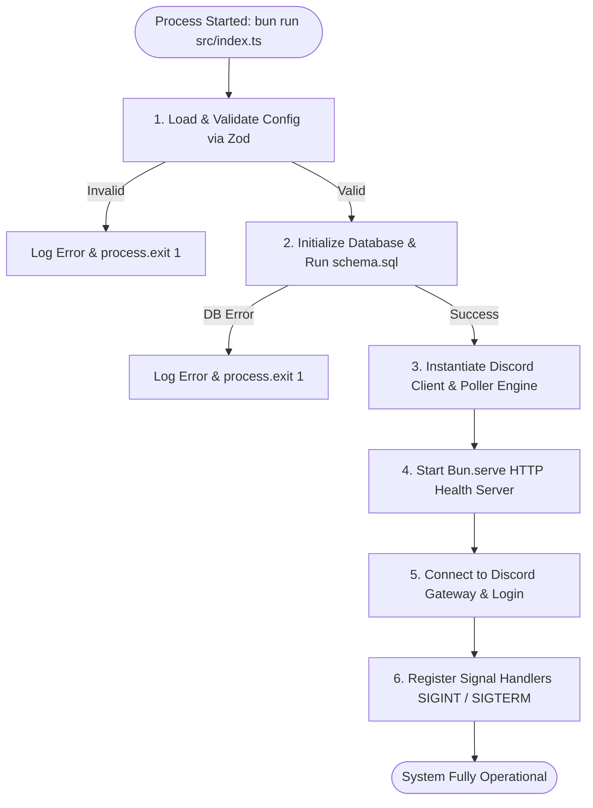
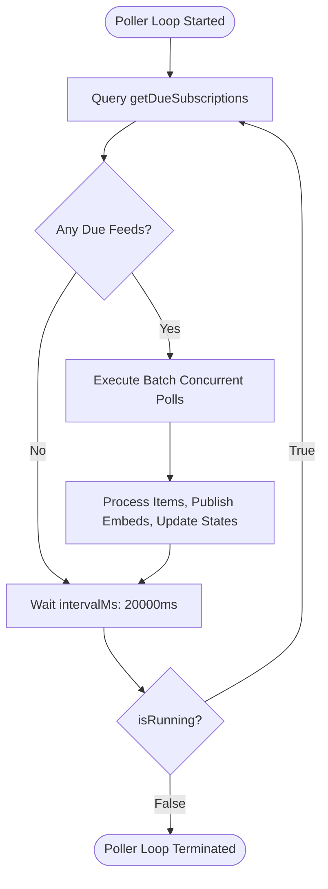
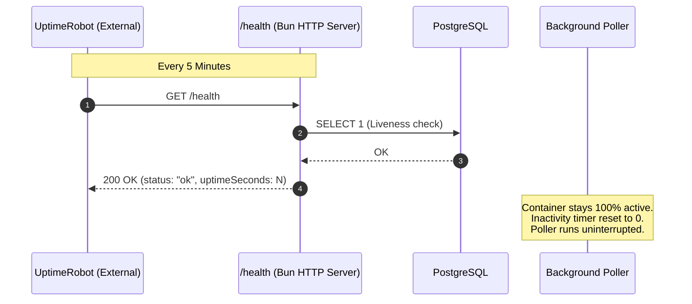

# Lifecycle, Event Loop & Resilience

This document details the process lifecycle of the RSS Discord Bot, spanning startup bootstrapping, asynchronous event loop orchestration, graceful termination, and Render free-tier sleep mitigation.

---

## 🚀 Startup Bootstrapping Sequence

The application bootstrap sequence is defined in [`src/index.ts`](file:///home/afnan/Projects/rss-bot/src/index.ts) and executed in a deterministic 6-step lifecycle:



### Detailed Bootstrapping Steps

1. **Environment Configuration Validation ([`src/config.ts`](file:///home/afnan/Projects/rss-bot/src/config.ts))**:
   - Environment variables are parsed against `configSchema`.
   - If any required variable (`DATABASE_URL`, `DISCORD_TOKEN`, `DISCORD_CLIENT_ID`) is missing or invalid, an explicit, formatted error report is printed to `stderr` and the process exits with code 1.
2. **Database Initialization ([`src/db/client.ts`](file:///home/afnan/Projects/rss-bot/src/db/client.ts#L42-L52))**:
   - Establishes connection pool to PostgreSQL.
   - Reads [`src/db/schema.sql`](file:///home/afnan/Projects/rss-bot/src/db/schema.sql) from disk and executes it using `sql.unsafe()`.
   - Creates all missing tables (`guilds`, `subscriptions`, `feed_items`, `feed_state`) and creates indexes idempotently (`IF NOT EXISTS`).
3. **Component Instantiation**:
   - Creates the `discord.js` client with minimal gateway intents (`GatewayIntentBits.Guilds`).
   - Instantiates `RssPoller`, injecting the Discord client instance.
4. **HTTP Server Binding ([`src/http/health.ts`](file:///home/afnan/Projects/rss-bot/src/http/health.ts))**:
   - Binds native `Bun.serve` on `0.0.0.0:${PORT}` (default port: 3000).
   - Starts listening for incoming Render port checks and UptimeRobot monitoring pings immediately, even before Discord Gateway completes identification.
5. **Gateway Login & Command Sync ([`src/bot/client.ts`](file:///home/afnan/Projects/rss-bot/src/bot/client.ts#L49-L75))**:
   - Authenticates against the Discord Gateway using `DISCORD_TOKEN`.
   - Once `Events.ClientReady` fires:
     - Automatically registers slash commands (guild-scoped if `DISCORD_GUILD_ID` is set, otherwise globally).
     - Boots the polling loop via `poller.start(20000)`.
6. **Signal Registration**:
   - Hooks into Node/Bun runtime events for `SIGINT` and `SIGTERM`.

---

## ⏱️ Polling Event Loop Architecture

The polling engine in [`src/rss/poller.ts`](file:///home/afnan/Projects/rss-bot/src/rss/poller.ts#L27-L47) avoids `setInterval` because fixed intervals can stack overlapping execution cycles if a batch of feeds experiences network latency.

Instead, it implements a **recursive self-scheduling loop** using `setTimeout`:



### Self-Scheduling Guarantees
- **No Overlapping Cycles**: The next cycle cannot schedule until the prior cycle completes all asynchronous work and enters the `finally` block.
- **Initial Stagger**: When the bot boots, the first poll waits `2,000ms` to allow the Discord client and Gateway connection to stabilize.
- **Configurable Cadence**: The default checking tick is 20 seconds (`intervalMs = 20000`). Each tick evaluates which feeds have reached `feed_state.next_check_at <= NOW()`.

---

## 🛑 Graceful Shutdown Orchestration

During deployments, container restarts, or manual cancellations (`Ctrl+C`), the process intercepts OS termination signals (`SIGINT`, `SIGTERM`) to clean up resources cleanly without corrupting database states or leaving orphan connections.

The graceful shutdown routine in [`src/index.ts`](file:///home/afnan/Projects/rss-bot/src/index.ts#L46-L66) enforces an orderly teardown:

```typescript
const gracefulShutdown = async (signal: string) => {
  if (isShuttingDown) return;
  isShuttingDown = true;
  console.log(`\n[Shutdown] Received ${signal}. Initiating graceful shutdown...`);

  try {
    poller.stop();            // 1. Cancel polling timers and prevent new ticks
    healthServer.stop();      // 2. Cease accepting HTTP traffic
    discordClient.destroy();  // 3. Close Discord Gateway WebSocket connection
    await closeDatabase();    // 4. Drain and close PostgreSQL connection pool
    console.log("[Shutdown] All services stopped cleanly. Bye!");
    process.exit(0);
  } catch (err) {
    console.error("[Shutdown] Error during shutdown:", err);
    process.exit(1);
  }
};
```

### Shutdown Safeguards
1. **Idempotency Guard**: `isShuttingDown` flag prevents multiple rapid signals from triggering simultaneous shutdown sequences.
2. **Database Pool Drain**: `closeDatabase()` calls `sqlInstance.end({ timeout: 5 })`, ensuring active database transactions are given up to 5 seconds to finish before the connection is severed.
3. **Gateway Clean Disconnect**: `discordClient.destroy()` sends a clean disconnect payload to Discord, preventing the bot from appearing ghost-online.

---

## 💤 Render Free-Tier Sleep Mitigation

### The Problem
Render's **Free Web Service** tier automatically puts containers to sleep after **15 minutes** of HTTP inactivity. If the service sleeps, the internal background poller stops running, and new RSS feed updates will not be posted to Discord until an incoming HTTP request wakes the server up.

### The Solution: Keep-Alive Loop with UptimeRobot



1. **UptimeRobot Ping**: An external monitor queries `https://your-bot.onrender.com/health` once every **5 minutes**.
2. **Timer Reset**: Every incoming request resets Render's 15-minute inactivity countdown, guaranteeing the container never sleeps.
3. **Dual Verification**: The `/health` handler executes `SELECT 1` on PostgreSQL and inspects the Discord Gateway WebSocket status. If the database drops, `/health` returns `503 Service Unavailable`, prompting UptimeRobot to send an alert.
