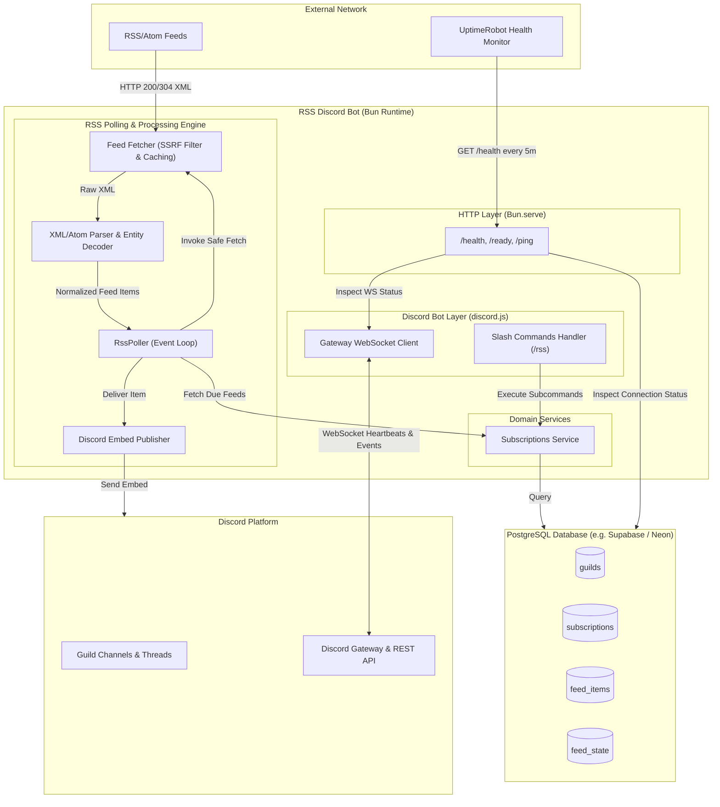
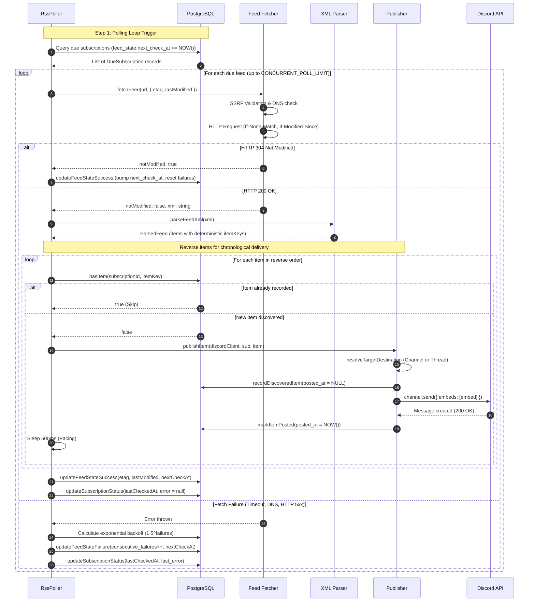
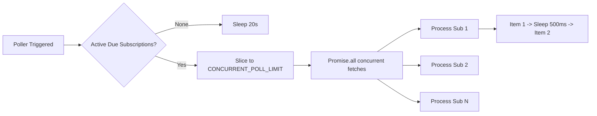

# Architecture Overview

The **RSS Discord Bot** is engineered as an event-driven, resilient, and stateless micro-service. Its primary objective is to poll external RSS/Atom feeds, normalize heterogeneous XML representations into structured representations, identify new entries without duplicates, and format and broadcast rich embeds to target Discord channels or dedicated threads.

---

## 🏛️ High-Level System Architecture

The following diagram illustrates the boundary between the bot's runtime environment, external RSS providers, persistence services, and the Discord API.

---

## 🔄 End-to-End Processing Workflow

The polling lifecycle operates independently of interactive slash commands. Every cycle follows a deterministic pipeline to ensure data consistency, rate-limit compliance, and duplicate prevention.

---

## 🧩 Architectural Subsystems

### 1. Polling & Scheduler Engine ([`src/rss/poller.ts`](file:///home/afnan/Projects/rss-bot/src/rss/poller.ts))
- Implements a self-rescheduling timer loop using `setTimeout` rather than fixed `setInterval` to eliminate overlapping executions or execution skew under heavy load.
- Retrieves due subscriptions using a database cursor (`next_check_at <= NOW()`), prioritizing the most overdue feeds.
- Enforces batch concurrency limits configured via `CONCURRENT_POLL_LIMIT` (default: 5 concurrent feeds).
- Reverses feed items before publication so that when a feed outputs articles in newest-to-oldest order, they appear in Discord in chronological sequence.

### 2. Network Fetcher & SSRF Firewall ([`src/rss/fetcher.ts`](file:///home/afnan/Projects/rss-bot/src/rss/fetcher.ts))
- Acts as a security proxy between the bot and the open internet.
- Enforces strict protocol validation (only `http:` and `https:`).
- Performs asynchronous multi-record DNS resolution via Node's `dns/promises.lookup` to inspect all underlying IPv4 and IPv6 addresses.
- Rejects requests targeting loopback, RFC 1918 subnets, Carrier-Grade NAT (RFC 6598), Link-Local/Cloud Metadata (`169.254.169.254`), and IPv6 private/multicast addresses.
- Transmits HTTP conditional headers (`If-None-Match`, `If-Modified-Since`) and processes `304 Not Modified` responses to conserve egress bandwidth.
- Implements request cancellation through `AbortController` bounded by `FETCH_TIMEOUT_MS` (default: 10,000ms) and enforces a strict 5MB payload ceiling.

### 3. XML Parser & Sanitization Engine ([`src/rss/parser.ts`](file:///home/afnan/Projects/rss-bot/src/rss/parser.ts))
- Leverages `fast-xml-parser` with attribute preservation and string preservation to prevent arbitrary type-casting bugs.
- Uniformly normalizes RSS 0.9x, RSS 1.0 (RDF), RSS 2.0, and Atom 1.0 specifications into a single internal representation (`ParsedFeedItem`).
- Sanitizes untrusted content with `stripHtmlAndDecode`: strips `<script>`, `<style>`, HTML tags, and converts decimal, hex, and named HTML entities into plain text.
- Extracts visual content across RSS `<enclosure>`, Yahoo `<media:content>`, and `<media:thumbnail>` tags.
- Computes deterministic, unique identifiers (`itemKey`) through a 3-tier cascade: `<guid>` / `<id>` $\to$ canonical `<link>` $\to$ SHA-256 hash of `title::publishedAt`.

### 4. Relational Persistence Layer ([`src/db/`](file:///home/afnan/Projects/rss-bot/src/db/))
- Powered by `postgres` (Porsager's postgres.js driver), providing connection pooling, automatic reconnects, and native type serialization.
- Maintains database state across four core tables: `guilds`, `subscriptions`, `feed_items`, and `feed_state`.
- All relational state cascades on deletion: deleting a guild or subscription cleanly prunes associated items and state records with zero dangling orphans.

### 5. Discord Delivery & Threading ([`src/services/publisher.ts`](file:///home/afnan/Projects/rss-bot/src/services/publisher.ts))
- Formats parsed articles into rich, responsive Discord embeds featuring RSS branding (`#ff7700`), truncated descriptions, timestamps, author metadata, and lead images.
- Implements dedicated thread lifecycle management: automatically provisions public threads on setup, detects archived threads, and proactively unarchives them prior to sending messages.
- Introduces artificial 500ms pacing delays between successive message posts to adhere to Discord API rate limits.

### 6. HTTP Health & Keep-Alive Server ([`src/http/health.ts`](file:///home/afnan/Projects/rss-bot/src/http/health.ts))
- Built on native `Bun.serve` to avoid overhead from heavy frameworks.
- Binds to `0.0.0.0:${PORT}` and exposes `/health`, `/ready`, and `/ping`.
- Serves as the integration point for **Render's Free Web Service** liveness probes and **UptimeRobot's** 5-minute keep-alive ping.

---

## 🔒 Concurrency & Failure Model

1. **Horizontal Feed Concurrency**: Feeds are polled in parallel up to `CONCURRENT_POLL_LIMIT` (default: 5). This prevents a single slow origin server from blocking other feeds.
2. **Serial Item Publication**: Within a given feed, new items are published sequentially with a 500ms pause between messages to avoid Discord HTTP 429 (Rate Limited) errors.
3. **Exponential Failure Backoff**: When a feed fails (e.g. DNS timeout, 500 Internal Server Error, or XML parse failure), the poller increases `consecutive_failures` and calculates:
   $$\Delta t = \text{poll\_interval\_seconds} \times \min(1.5^{\text{consecutive\_failures}}, 24)$$
   This protects origin feed servers from aggressive retries during extended outages while maintaining responsive recovery once service is restored.
