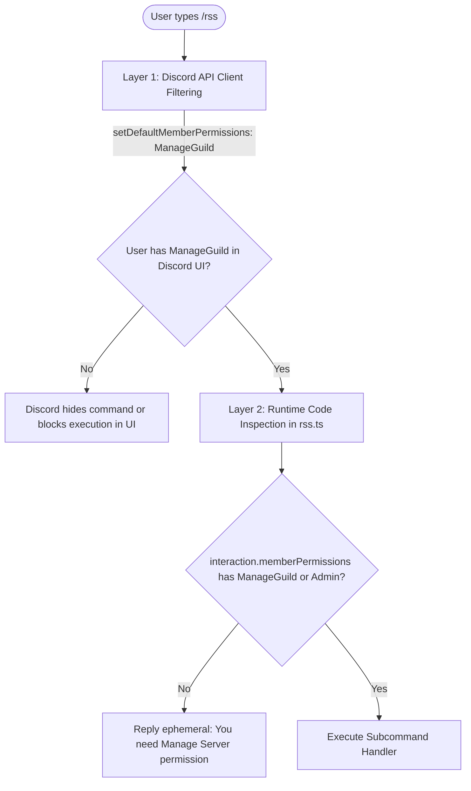

# Discord Bot Client & Command Handlers

The Discord bot layer handles interaction with Discord's WebSocket Gateway, slash command registration via the Discord REST API, dual-layer permission enforcement, and interactive command execution.

---

## 📄 File Overview

| File | Purpose |
| :--- | :--- |
| [`src/bot/client.ts`](file:///home/afnan/Projects/rss-bot/src/bot/client.ts) | Discord client lifecycle, intent selection, event routing, and top-level error boundaries. |
| [`src/bot/commands.ts`](file:///home/afnan/Projects/rss-bot/src/bot/commands.ts) | Declarative slash command definitions and Discord REST API command registration. |
| [`src/bot/handlers/rss.ts`](file:///home/afnan/Projects/rss-bot/src/bot/handlers/rss.ts) | Subcommand handlers, runtime authorization checks, and embed responses. |

---

## 🔒 Gateway Intents & Client Architecture

### Intent Minimization
The client is instantiated in [`src/bot/client.ts#L12-L16`](file:///home/afnan/Projects/rss-bot/src/bot/client.ts#L12-L16):

```typescript
const client = new Client({
  intents: [GatewayIntentBits.Guilds],
});
```

- **Security & Privacy**: The bot requests only `GatewayIntentBits.Guilds`. It **does not require** any Privileged Gateway Intents (such as `MessageContent`, `GuildMembers`, or `GuildPresences`).
- **Resource Efficiency**: Without message caching or presence tracking, memory consumption remains minimal (typically $< 60\text{MB}$ under Bun).

### Top-Level Interaction Error Boundary
[`src/bot/client.ts#L25-L44`](file:///home/afnan/Projects/rss-bot/src/bot/client.ts#L25-L44)

If any uncaught exception bubbles up from command handlers, the global boundary captures it and informs the user gracefully:
```typescript
try {
  await handleRssCommand(interaction);
} catch (err) {
  console.error("[Discord] Uncaught error in /rss interaction:", err);
  const replyMsg = {
    content: "❌ An internal error occurred while processing the command.",
    ephemeral: true,
  };
  if (interaction.deferred || interaction.replied) {
    await interaction.followUp(replyMsg).catch(() => {});
  } else {
    await interaction.reply(replyMsg).catch(() => {});
  }
}
```

---

## 📜 Slash Command Registration (`src/bot/commands.ts`)

Slash commands are declared using `SlashCommandBuilder` and registered via Discord's REST API (v10):

### Registration Routes
- **Development Mode (`DISCORD_GUILD_ID` provided)**:
  Uses `Routes.applicationGuildCommands(clientId, guildId)`. Updates appear in Discord **instantly** on boot.
- **Production Mode (Global)**:
  Uses `Routes.applicationCommands(clientId)`. Updates are registered globally across all servers.

---

## 🛡️ Dual-Layer Permission Enforcement

To ensure unprivileged users cannot modify feed configurations, permissions are enforced at **two distinct levels**:



1. **Layer 1: API Level (`setDefaultMemberPermissions`)**:
   [`src/bot/commands.ts#L12-L13`](file:///home/afnan/Projects/rss-bot/src/bot/commands.ts#L12-L13)
   Configured with `.setDefaultMemberPermissions(PermissionFlagsBits.ManageGuild)` and `.setDMPermission(false)`. Discord prevents non-managers from seeing or invoking the command in the client.
2. **Layer 2: Runtime Execution Check**:
   [`src/bot/handlers/rss.ts#L29-L41`](file:///home/afnan/Projects/rss-bot/src/bot/handlers/rss.ts#L29-L41)
   The handler inspects `interaction.memberPermissions` directly:
   ```typescript
   const isAuthorized =
     memberPermissions?.has(PermissionFlagsBits.ManageGuild) ||
     memberPermissions?.has(PermissionFlagsBits.Administrator);
   ```
   If authorization is absent, an ephemeral error is returned immediately without executing any database or network operations.

---

## ⚙️ Subcommand Execution Handlers (`src/bot/handlers/rss.ts`)

All subcommands invoke `await interaction.deferReply({ ephemeral: true })` upfront. This ensures that slow remote feed lookups or thread creations never trigger Discord's 3-second interaction timeout (`Unknown interaction 10062`).

| Handler | Subcommand | Key Actions & Validations |
| :--- | :--- | :--- |
| `handleAdd` | `/rss add` | Validates target channel type (`GuildText` or `GuildAnnouncement`), verifies bot permissions (`ViewChannel`, `SendMessages`, `EmbedLinks`), invokes `addSubscription()`, returns confirmation embed with baseline item count. |
| `handleRemove` | `/rss remove` | Validates ownership by guild ID, calls `removeSubscription()`, confirms cascade deletion of feed items. |
| `handleList` | `/rss list` | Lists all subscriptions for the guild up to 25 items, displays status badges (`🟢 Active`, `⏸️ Paused`, `⚠️ Error`), polling interval, and Discord relative timestamp `<t:timestamp:R>`. |
| `handleTest` | `/rss test` | Validates and parses feed in real-time via `previewFeed()`, formats and returns the latest article as an embed without subscribing. |
| `handlePause` | `/rss pause` | Toggles `enabled = false` for the subscription ID. |
| `handleResume` | `/rss resume` | Toggles `enabled = true` for the subscription ID. |
| `handleCheck` | `/rss check` | Sets `feed_state.next_check_at = NOW()` to force immediate checking on the next polling tick. |
| `handleStatus` | `/rss status` | Displays detailed diagnostics: consecutive failure count, ETag caching active state, last success timestamp, and last error string. |
