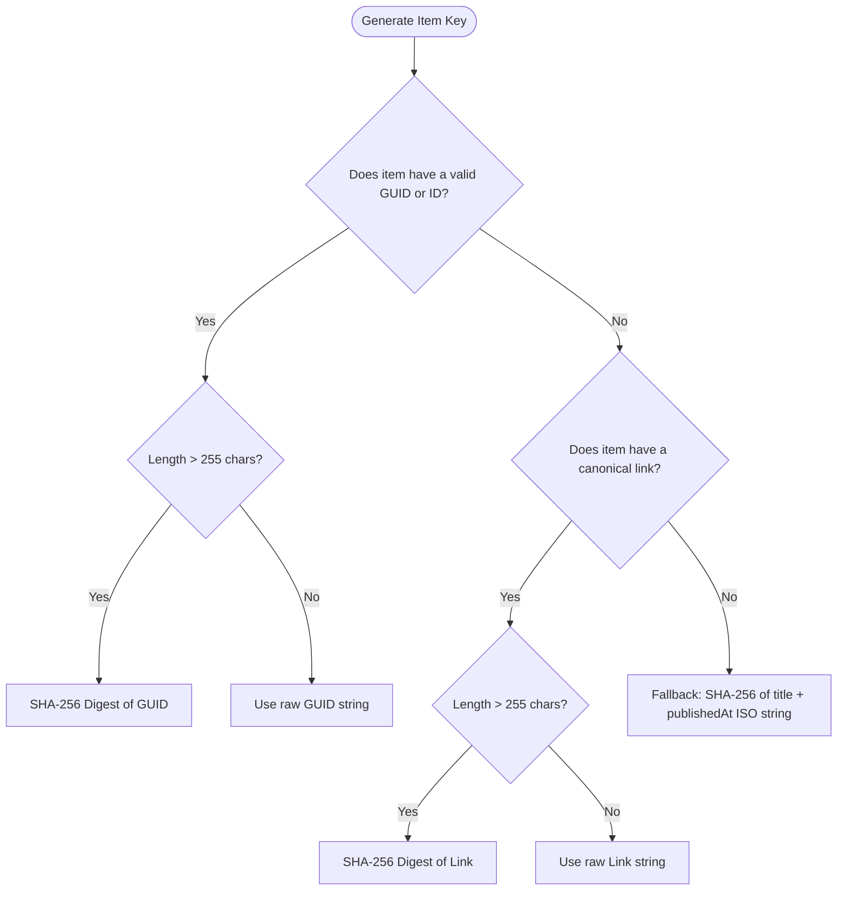

# Feed Parser Engine

The parser module in [`src/rss/parser.ts`](file:///home/afnan/Projects/rss-bot/src/rss/parser.ts) converts raw RSS 2.0, RSS 0.9x, RSS 1.0 (RDF), and Atom 1.0 XML documents into strongly typed, sanitized, and normalized data structures. It also generates deterministic identity keys (`itemKey`) to guarantee duplicate prevention.

---

## 📄 Source File Overview

- **Source Code**: [`src/rss/parser.ts`](file:///home/afnan/Projects/rss-bot/src/rss/parser.ts)
- **Unit Tests**: [`tests/parser.test.ts`](file:///home/afnan/Projects/rss-bot/tests/parser.test.ts)
- **Dependencies**: `fast-xml-parser`, `node:crypto`

---

## 📐 Data Models

```typescript
export interface ParsedFeedItem {
  itemKey: string;           // Deterministic unique identifier
  title: string;             // Sanitized plaintext title
  link: string | null;       // Canonical article URL
  description: string | null;// Plaintext summary stripped of HTML markup
  publishedAt: Date | null;  // Parsed publication date
  author: string | null;     // Author or creator name
  imageUrl: string | null;   // Extracted lead image or enclosure URL
}

export interface ParsedFeed {
  title: string;             // Channel / Feed title
  description: string | null;// Feed description or subtitle
  link: string | null;       // Main website link
  items: ParsedFeedItem[];   // Collection of feed items
}
```

---

## ⚙️ Fast-XML-Parser Configuration

The parser instantiates `XMLParser` with strict configuration parameters:

```typescript
const xmlParser = new XMLParser({
  ignoreAttributes: false,
  attributeNamePrefix: "@_",
  trimValues: true,
  parseTagValue: false, // Prevents unintended type coercion
});
```

- **`ignoreAttributes: false`**: Required to parse XML attributes like Atom links `<link href="..."/>` and enclosures `<enclosure url="..."/>`.
- **`attributeNamePrefix: "@_"`**: Namespaces attributes (e.g. `@_href`) cleanly to prevent collisions with child tag names.
- **`parseTagValue: false`**: Crucial design choice. Prevents fast-xml-parser from parsing date strings or numeric IDs into native numbers, which could lead to truncation of large IDs or unexpected date formatting glitches.

---

## 🧹 HTML Sanitization & Entity Decoding

### `stripHtmlAndDecode(input: string): string`
[`src/rss/parser.ts#L28-L54`](file:///home/afnan/Projects/rss-bot/src/rss/parser.ts#L28-L54)

RSS feeds routinely contain arbitrary HTML, inline CSS styles, tracking scripts, and HTML character references. Discord embeds do not render HTML and have strict length limits.

`stripHtmlAndDecode` executes a multi-stage regex transformation cascade:

```typescript
export function stripHtmlAndDecode(input: string): string {
  if (!input) return "";
  return input
    .replace(/<style[\s\S]*?<\/style>/gi, "")           // 1. Remove style blocks
    .replace(/<script[\s\S]*?<\/script>/gi, "")         // 2. Remove script blocks
    .replace(/<br\s*\/?>/gi, " ")                       // 3. Convert <br> to spaces
    .replace(/<\/(p|div|li|tr|h[1-6])>/gi, " ")         // 4. Convert block closures to spaces
    .replace(/<[^>]+>/g, "")                            // 5. Strip all remaining HTML tags
    .replace(/&amp;/g, "&")                             // 6. Decode named entities
    .replace(/&lt;/g, "<")
    .replace(/&gt;/g, ">")
    .replace(/&quot;/g, '"')
    .replace(/&#39;/g, "'")
    .replace(/&apos;/g, "'")
    .replace(/&#x27;/g, "'")
    .replace(/&nbsp;/g, " ")
    .replace(/&#(\d+);/g, (_, dec) => {                 // 7. Decode decimal entities (e.g. &#8217;)
      const code = parseInt(dec, 10);
      return !isNaN(code) ? String.fromCharCode(code) : "";
    })
    .replace(/&#x([0-9a-f]+);/gi, (_, hex) => {         // 8. Decode hex entities (e.g. &#x2F;)
      const code = parseInt(hex, 16);
      return !isNaN(code) ? String.fromCharCode(code) : "";
    })
    .replace(/\s+/g, " ")                               // 9. Normalize multiple whitespace
    .trim();
}
```

---

## 🔑 Deterministic `itemKey` Generation

### `generateItemKey(...)`
[`src/rss/parser.ts#L139-L158`](file:///home/afnan/Projects/rss-bot/src/rss/parser.ts#L139-L158)

To prevent duplicate posts across feed modifications or reordering, every item must possess a deterministic, unique, collision-resistant string identifier bounded by PostgreSQL's `VARCHAR`/`TEXT` indexing limits:



1. **Tier 1: Stable GUID / Atom ID**: If `<guid>` or `<id>` exists, it is used directly. If the string exceeds 255 characters, it is hashed with SHA-256.
2. **Tier 2: Canonical Article URL**: If no GUID is provided, the article `<link>` is utilized.
3. **Tier 3: Content Fingerprint Fallback**: If neither a GUID nor a URL exists, a deterministic SHA-256 hash is computed across `${title}::${publishedAt.toISOString()}`.

---

## 🖼️ Media & Image Extraction

### `extractImage(node: unknown): string | null`
[`src/rss/parser.ts#L108-L137`](file:///home/afnan/Projects/rss-bot/src/rss/parser.ts#L108-L137)

The parser inspects feed entries across multiple RSS and Atom media specifications:

1. **Standard RSS Enclosures**:
   ```xml
   <enclosure url="https://example.com/hero.jpg" type="image/jpeg" length="12345" />
   ```
   Checks that `type` is absent or starts with `image/`.
2. **Yahoo Media RSS (`media:content`)**:
   ```xml
   <media:content url="https://example.com/image.png" medium="image" />
   ```
3. **Yahoo Media RSS Thumbnails (`media:thumbnail`)**:
   ```xml
   <media:thumbnail url="https://example.com/thumb.jpg" />
   ```

---

## 🔄 Format Handling: RSS 2.0 vs Atom 1.0

### `parseFeedXml(xmlContent: string): ParsedFeed`
[`src/rss/parser.ts#L160-L275`](file:///home/afnan/Projects/rss-bot/src/rss/parser.ts#L160-L275)

The parser automatically detects the root container:

| Feed Type | Root Marker | Channel Metadata | Items Array | Item Identifier |
| :--- | :--- | :--- | :--- | :--- |
| **RSS 2.0 / 0.9x** | `parsed.rss` | `rss.channel` | `channel.item` | `<guid>` |
| **RSS 1.0 (RDF)** | `parsed["rdf:RDF"]` | `root.channel` | `root.item` or `channel.item` | `<dc:identifier>` / `<link>` |
| **Atom 1.0** | `parsed.feed` | `feed` | `feed.entry` | `<id>` |

### Atom Link Handling (`extractLink`)
In Atom, links can be an array of `<link>` objects with attributes:
- Prefers entries with `@_rel="alternate"` (the canonical web link).
- Ignores `@_rel="self"` (the feed XML URL itself).
- Falls back to the first available link if no alternate is explicitly flagged.
