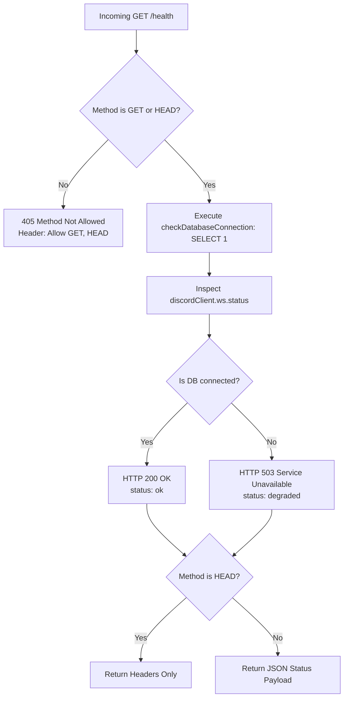

# Health & Readiness HTTP Server

The HTTP server subsystem in [`src/http/health.ts`](file:///home/afnan/Projects/rss-bot/src/http/health.ts) provides lightweight, high-performance liveness and readiness monitoring endpoints powered by **`Bun.serve`**. It integrates directly with container orchestration platforms (such as Render) and third-party uptime monitors (such as UptimeRobot).

---

## 📄 File Overview

- **Source Code**: [`src/http/health.ts`](file:///home/afnan/Projects/rss-bot/src/http/health.ts)
- **Unit Tests**: [`tests/health.test.ts`](file:///home/afnan/Projects/rss-bot/tests/health.test.ts)
- **Runtime API**: `Bun.serve`

---

## 🌐 Endpoints & Routing

The server binds to `0.0.0.0:${PORT}` (configured via `PORT` and `HOST`).

| Route | Supported Methods | Response Code | Description |
| :--- | :--- | :--- | :--- |
| `/health` | `GET`, `HEAD` | `200` / `503` | Comprehensive liveness & readiness check (Database + Discord Gateway). |
| `/ready` | `GET`, `HEAD` | `200` / `503` | Alias to `/health` for Kubernetes / container readiness probes. |
| `/` | `GET`, `HEAD` | `200` / `503` | Default root health probe endpoint. |
| `/ping` | `GET`, `HEAD` | `200` | Ultra-lightweight ping probe (returns plain text `"pong"`). |
| Other | Any | `404` | Returns `Response("Not Found", { status: 404 })`. |

---

## 📊 Health Check Architecture (`/health` & `/ready`)



### JSON Response Schema

```json
{
  "status": "ok",
  "timestamp": "2026-10-31T09:30:00.000Z",
  "uptimeSeconds": 86400,
  "services": {
    "database": "connected",
    "discord": "ready"
  }
}
```

### Field Definitions

- **`status`**: `"ok"` if all critical services are healthy; `"degraded"` if database connectivity has failed.
- **`timestamp`**: Current ISO 8601 server timestamp.
- **`uptimeSeconds`**: Total continuous seconds the process has been running (`Math.floor(process.uptime())`).
- **`services.database`**: `"connected"` if `SELECT 1` succeeded; `"disconnected"` otherwise.
- **`services.discord`**: String mapped from Discord's internal `ws.status` enum.

### Cache Prevention
All health responses transmit explicit cache prevention headers:
```http
Cache-Control: no-store, no-cache, must-revalidate
Content-Type: application/json
```
This guarantees that intermediate CDNs, proxies, or cloud routers never serve stale health states to monitoring agents.

---

## 🔌 Discord WebSocket Status Mapping

### `getDiscordStatusText(status: Status): string`
[`src/http/health.ts#L6-L29`](file:///home/afnan/Projects/rss-bot/src/http/health.ts#L6-L29)

Maps `discord.js` internal numeric status codes into human-readable strings:

| Enum Value (`Status`) | Output String | System Meaning |
| :--- | :--- | :--- |
| `Status.Ready` (0) | `"ready"` | Gateway connection open, session initialized, guilds synced. |
| `Status.Connecting` (1) | `"connecting"` | TCP socket connecting to Discord Gateway. |
| `Status.Reconnecting` (2)| `"reconnecting"`| Gateway connection dropped; attempting automatic reconnect. |
| `Status.Idle` (3) | `"idle"` | WebSocket idle. |
| `Status.Nearly` (4) | `"nearly"` | Almost ready; awaiting final state sync. |
| `Status.Disconnected` (5)| `"disconnected"`| Disconnected from Discord Gateway. |
| `Status.WaitingForGuilds` (6)| `"waiting_for_guilds"` | Connection established; receiving guild streams. |
| `Status.Identifying` (7) | `"identifying"` | Sending OAuth / Identify token handshake to Gateway. |
| `Status.Resuming` (8) | `"resuming"` | Resuming dropped session via Resume packet. |
| Other / undefined | `"unknown"` | Gateway client uninitialized or state unmapped. |

---

## 🏓 The `/ping` Endpoint

[`src/http/health.ts#L84-L97`](file:///home/afnan/Projects/rss-bot/src/http/health.ts#L84-L97)

Designed for high-frequency internal TCP/HTTP load balancers and container orchestrators:
- Executes **zero** database queries.
- Bypasses JSON serialization.
- Responds with `200 OK` and plain text `"pong"`.
