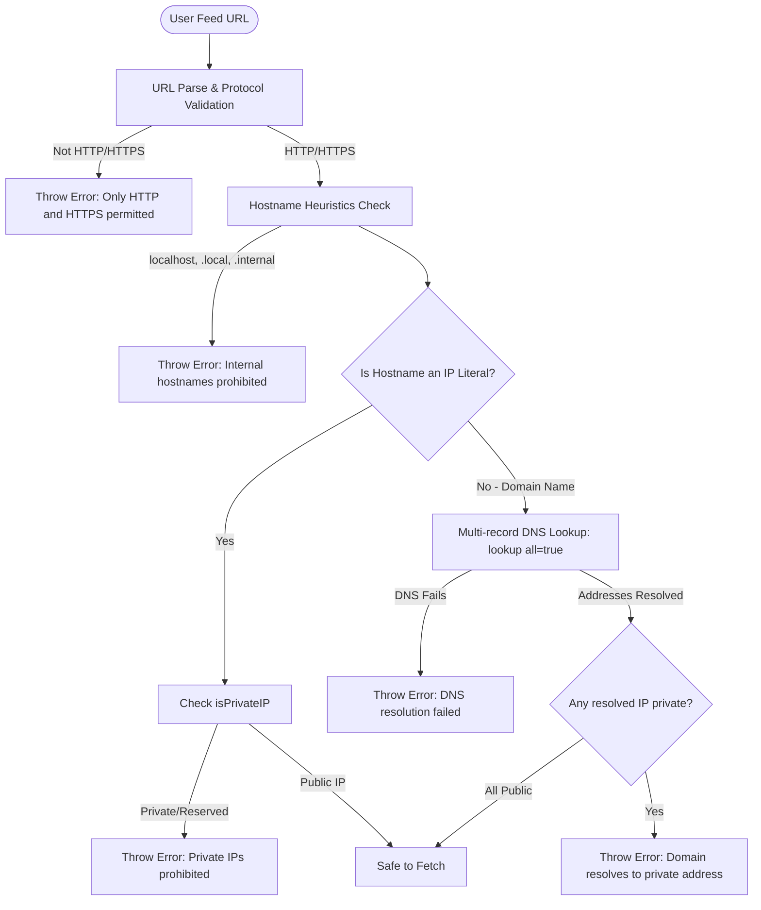

# Network Fetcher & SSRF Defense

The network fetching subsystem in [`src/rss/fetcher.ts`](file:///home/afnan/Projects/rss-bot/src/rss/fetcher.ts) manages HTTP data acquisition from third-party RSS and Atom servers. Because users can submit arbitrary feed URLs via the `/rss add` command, this module serves as a critical security perimeter against **Server-Side Request Forgery (SSRF)**, cloud metadata exploitation, and internal subnet scanning.

---

## 📄 File Overview

- **Source Code**: [`src/rss/fetcher.ts`](file:///home/afnan/Projects/rss-bot/src/rss/fetcher.ts)
- **Unit Tests**: [`tests/ssrf.test.ts`](file:///home/afnan/Projects/rss-bot/tests/ssrf.test.ts)
- **Standard Library**: `node:dns/promises`, `node:net`

---

## 🛡️ SSRF Firewall Architecture

Allowing a server to fetch arbitrary user-supplied URLs introduces serious vulnerabilities:
1. **Cloud Metadata Exfiltration**: Fetching `http://169.254.169.254/latest/meta-data` on AWS/GCP/Render could expose IAM credentials or container tokens.
2. **Localhost & Subnet Probing**: Accessing `http://127.0.0.1:5432` or internal container interfaces (e.g. `10.0.0.0/8`, `172.16.0.0/12`) could probe internal infrastructure.
3. **Protocol Smuggling**: Requesting `file:///etc/passwd`, `gopher://`, or `ftp://` could read filesystem data or execute protocol injection.

### Defense Pipeline



---

## 🔬 Subnet Filtering Rules

### IPv4 Boundaries ([`isPrivateIPv4`](file:///home/afnan/Projects/rss-bot/src/rss/fetcher.ts#L16-L54))

Every IPv4 address is split into octets (`[b0, b1, b2, b3]`) and evaluated against the following standards:

| Subnet Range | RFC Reference | Classification / Threat |
| :--- | :--- | :--- |
| `0.0.0.0/8` | RFC 1122 | Current network ("this" host) |
| `10.0.0.0/8` | RFC 1918 | Private-use network |
| `100.64.0.0/10` | RFC 6598 | Shared Address Space / Carrier-Grade NAT |
| `127.0.0.0/8` | RFC 1122 | Loopback interfaces (`127.0.0.1`) |
| `169.254.0.0/16` | RFC 3927 | Link-Local / Cloud Instance Metadata (`169.254.169.254`) |
| `172.16.0.0/12` | RFC 1918 | Private-use network (Docker default bridge `172.17.0.0/16`) |
| `192.0.0.0/24` | RFC 6890 | IETF Protocol Assignments |
| `192.0.2.0/24` | RFC 5737 | Documentation (TEST-NET-1) |
| `192.168.0.0/16` | RFC 1918 | Private-use network (Local home/office LANs) |
| `198.18.0.0/15` | RFC 2544 | Benchmarking networks |
| `198.51.100.0/24`| RFC 5737 | Documentation (TEST-NET-2) |
| `203.0.113.0/24` | RFC 5737 | Documentation (TEST-NET-3) |
| `224.0.0.0/4` | RFC 5771 | Multicast traffic (`224.0.0.0` - `239.255.255.255`) |
| `240.0.0.0/4` | RFC 1112 | Reserved for future use (`240.0.0.0` - `255.255.255.255`) |

### IPv6 Boundaries ([`isPrivateIPv6`](file:///home/afnan/Projects/rss-bot/src/rss/fetcher.ts#L59-L90))

Evaluates normalized lowercase IPv6 addresses:
- **Loopback**: `::1` or `0:0:0:0:0:0:0:1`.
- **Unspecified**: `::` or `0:0:0:0:0:0:0:0`.
- **IPv4-Mapped IPv6**: Addresses matching `::ffff:x.x.x.x` extract the IPv4 portion and recursively route it through `isPrivateIPv4()`.
- **Unique Local Addresses (ULA)**: Prefixes matching `fc00::/7` (starts with `fc` or `fd`).
- **Link-Local**: Prefixes matching `fe80::/10` (starts with `fe8`, `fe9`, `fea`, `feb`).
- **Multicast**: Prefixes matching `ff00::/8` (starts with `ff`).

---

## 🌐 DNS Resolution & Validation

### `validateFeedUrlSafe(urlString: string): Promise<URL>`
[`src/rss/fetcher.ts#L102-L151`](file:///home/afnan/Projects/rss-bot/src/rss/fetcher.ts#L102-L151)

1. **Protocol Check**: Rejects any scheme other than `http:` or `https:`.
2. **Hostname Blacklist**: Rejects hostnames equal to `"localhost"` or ending with `".local"` or `".internal"`.
3. **Literal IP Validation**: If the hostname is already an IP, checks `isPrivateIP(hostname)`.
4. **Multi-Record DNS Resolution**:
   ```typescript
   const addresses = await lookup(hostname, { all: true });
   ```
   Uses Node's `dns/promises.lookup` with `{ all: true }` to inspect **all** A (IPv4) and AAAA (IPv6) records returned for the host. If even a single resolved address falls into a private or restricted subnet, the entire request is rejected immediately with an explanatory error.

---

## ⚡ HTTP Caching & Conditional Requests

### `fetchFeed(urlString: string, state?: { etag?: string | null; lastModified?: string | null }): Promise<FetchFeedResult>`
[`src/rss/fetcher.ts#L157-L220`](file:///home/afnan/Projects/rss-bot/src/rss/fetcher.ts#L157-L220)

### Interface:
```typescript
export interface FetchFeedResult {
  notModified: boolean;
  status: number;
  xml?: string;
  etag: string | null;
  lastModified: string | null;
}
```

### Key Fetching Features

1. **Conditional Headers**:
   - If `state.etag` is present, sends: `If-None-Match: <etag>`
   - If `state.lastModified` is present, sends: `If-Modified-Since: <lastModified>`
2. **HTTP 304 Handling**:
   If the remote server returns `304 Not Modified`:
   - Returns `{ notModified: true, status: 304, etag, lastModified }`.
   - The poller immediately updates `feed_state.last_success_at` without re-downloading or re-parsing the XML.
3. **Timeout Enforcement**:
   An `AbortController` is coupled with `setTimeout` bounded by `FETCH_TIMEOUT_MS` (default 10,000ms). If the origin server stalls or hangs, the socket is aborted cleanly.
4. **Configurable Payload Size Guard (`MAX_FEED_SIZE_MB`, Default: 15MB)**:
   [`src/rss/fetcher.ts#L203-L245`](file:///home/afnan/Projects/rss-bot/src/rss/fetcher.ts#L203-L245)
   - **Early Header Check**: If the origin server returns a `Content-Length` header, it is checked upfront. If `contentLength > maxSizeBytes`, the fetch is rejected immediately before streaming bytes.
   - **Stream-Level Abort**: For chunked or unmetered responses, `response.body.getReader()` reads chunks sequentially into a `Uint8Array`. If cumulative `totalBytes > maxSizeBytes`:
     ```typescript
     await reader.cancel();
     throw new Error(`Feed payload exceeds ${config.MAX_FEED_SIZE_MB}MB limit`);
     ```
     The TCP stream is canceled immediately, preventing origin servers from exhausting container memory.
   - **Post-Decode Verification**: Performs a final character length verification after `chunks.join("")`.
