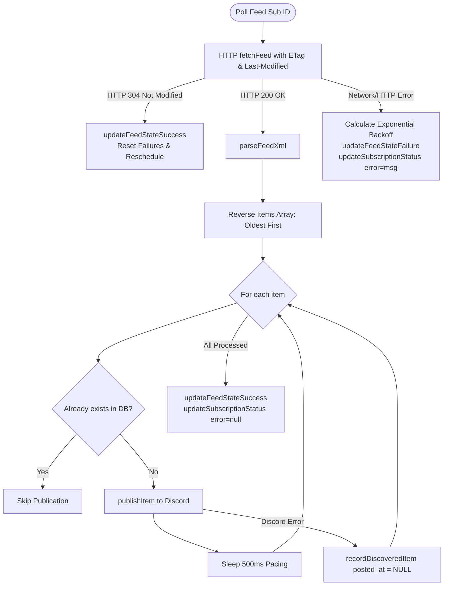

# Polling Engine

The polling engine in [`src/rss/poller.ts`](file:///home/afnan/Projects/rss-bot/src/rss/poller.ts) orchestrates recurring feed synchronization, batch concurrency management, Discord rate-limit pacing, and exponential backoff during origin outages.

---

## 📄 File Overview

- **Source Code**: [`src/rss/poller.ts`](file:///home/afnan/Projects/rss-bot/src/rss/poller.ts)
- **Primary Class**: `RssPoller`
- **Dependencies**: `discord.js`, [`src/rss/fetcher.ts`](file:///home/afnan/Projects/rss-bot/src/rss/fetcher.ts), [`src/rss/parser.ts`](file:///home/afnan/Projects/rss-bot/src/rss/parser.ts), [`src/services/publisher.ts`](file:///home/afnan/Projects/rss-bot/src/services/publisher.ts), [`src/db/repositories/`](file:///home/afnan/Projects/rss-bot/src/db/repositories/)

---

## ⚙️ The `RssPoller` Class

```typescript
export class RssPoller {
  private discordClient: Client;
  private isRunning = false;
  private timer: NodeJS.Timeout | null = null;
  private activePolls = 0;

  constructor(discordClient: Client) {
    this.discordClient = discordClient;
  }
  
  public start(intervalMs = 20000): void;
  public stop(): void;
  public async pollSubscription(sub: DueSubscription): Promise<void>;
  private async pollDueSubscriptions(): Promise<void>;
}
```

---

## 🔄 Polling Loop & Concurrency Controls

### Scheduling Cadence (`start` / `stop`)
- Polling is booted after Discord Gateway signals readiness (`Events.ClientReady`).
- The loop evaluates due feeds every **20 seconds** (`intervalMs = 20000`).
- The initial poll is delayed by **2,000ms** to allow the Discord client cache and database pool to stabilize.
- Calling `stop()` sets `isRunning = false` and cancels the active timeout.

### Concurrency Throttling (`pollDueSubscriptions`)
[`src/rss/poller.ts#L146-L162`](file:///home/afnan/Projects/rss-bot/src/rss/poller.ts#L146-L162)

To prevent resource exhaustion when thousands of feeds are tracked:
1. Queries `getDueSubscriptions(limit)` using the configured `CONCURRENT_POLL_LIMIT` (default: 5).
2. Uses `Promise.all` to poll the batch concurrently.
3. Once the batch finishes, the scheduler waits for the next 20-second tick before querying the next batch.

---

## 🛠️ Feed Processing Lifecycle (`pollSubscription`)

For each individual subscription:



### 1. HTTP 304 Handling
If `fetchResult.notModified === true`:
- The bot skips XML parsing entirely.
- It updates `feed_state.last_success_at` to `NOW()` and schedules the next check at `NOW() + poll_interval_seconds`.
- Zero Discord API calls are generated.

### 2. Chronological Ordering
Feeds almost universally order items newest-first at the top of the XML document. If 3 articles were published while the bot was offline, posting them newest-first would result in an inverted reading order in Discord.
The poller reverses the array:
```typescript
const itemsToInspect = [...parsedFeed.items].reverse();
```
This guarantees articles appear in the channel or thread in true chronological sequence.

### 3. Rate-Limit Pacing
When multiple articles are found in a single check, the poller injects an artificial 500ms delay between consecutive Discord messages:
```typescript
await new Promise((resolve) => setTimeout(resolve, 500));
```
This prevents triggering Discord's per-channel rate limits (typically 5 messages per 5 seconds).

### 4. Resilient Discovery on Discord Failure
If `publishItem()` fails (e.g. Discord API outage or network blip):
```typescript
await recordDiscoveredItem({
  subscriptionId: sub.id,
  itemKey: item.itemKey,
  itemUrl: item.link,
  title: item.title,
  publishedAt: item.publishedAt,
});
```
The article is persisted into `feed_items` with `posted_at = NULL`. This prevents losing track of discovered articles and allows future cycles to deliver unposted items via `getUnpostedItems()`.

---

## 📈 Exponential Backoff Dynamics

When an origin feed fails (e.g. HTTP 500, Cloudflare challenge, DNS resolution failure, or XML malformation), hammering the failing host on every normal interval is counterproductive.

The poller computes dynamic backoff in [`src/rss/poller.ts#L136-L139`](file:///home/afnan/Projects/rss-bot/src/rss/poller.ts#L136-L139):

$$\text{failures} = \text{consecutive\_failures} + 1$$
$$\text{multiplier} = \min\left(1.5^{\text{failures}}, 24\right)$$
$$\text{backoffSeconds} = \text{round}\left(\text{poll\_interval\_seconds} \times \text{multiplier}\right)$$
$$\text{nextCheckAt} = \text{now} + \text{backoffSeconds}$$

### Backoff Progression Example (10-Minute Base Interval)

| Failure Count | Multiplier ($1.5^N$) | Effective Check Delay | Next Attempt After Failure |
| :---: | :---: | :---: | :---: |
| 1 | $1.5^1 = 1.50$ | 15 minutes | +15 min |
| 2 | $1.5^2 = 2.25$ | 22.5 minutes | +23 min |
| 3 | $1.5^3 = 3.38$ | 33.8 minutes | +34 min |
| 4 | $1.5^4 = 5.06$ | 50.6 minutes | +51 min |
| 5 | $1.5^5 = 7.59$ | 75.9 minutes | +1 hr 16 min |
| 6 | $1.5^6 = 11.39$ | 113.9 minutes | +1 hr 54 min |
| 7 | $1.5^7 = 17.09$ | 170.9 minutes | +2 hr 51 min |
| 8+ | **Capped at 24.0** | **240 minutes (4 hours)** | **+4 hours** |

* **Recovery**: As soon as the origin server successfully returns HTTP 200 or 304, `updateFeedStateSuccess` resets `consecutive_failures` back to `0`, restoring normal polling frequency immediately.
