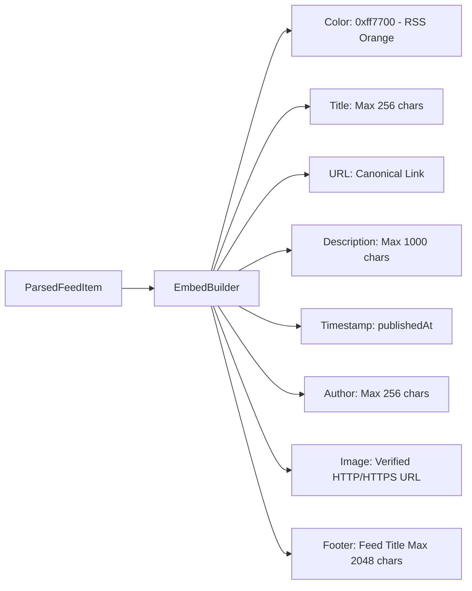
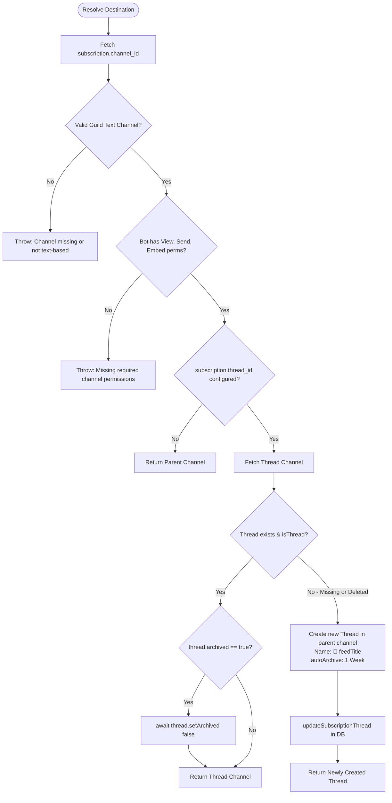

# Publishing Service

The publishing subsystem in [`src/services/publisher.ts`](file:///home/afnan/Projects/rss-bot/src/services/publisher.ts) bridges the internal feed representation and Discord's messaging layer. It is responsible for formatting Discord embeds, resolving delivery channels, managing dedicated thread lifecycles (including automatic unarchiving and recreation), and executing two-phase delivery tracking.

---

## 📄 File Overview

- **Source Code**: [`src/services/publisher.ts`](file:///home/afnan/Projects/rss-bot/src/services/publisher.ts)
- **Unit Tests**: [`tests/publisher.test.ts`](file:///home/afnan/Projects/rss-bot/tests/publisher.test.ts)
- **Dependencies**: `discord.js`, [`src/rss/parser.ts`](file:///home/afnan/Projects/rss-bot/src/rss/parser.ts), [`src/db/repositories/`](file:///home/afnan/Projects/rss-bot/src/db/repositories/)

---

## 🎨 Embed Construction

### `formatFeedEmbed(item: ParsedFeedItem, feedTitle?: string): EmbedBuilder`
[`src/services/publisher.ts#L19-L66`](file:///home/afnan/Projects/rss-bot/src/services/publisher.ts#L19-L66)

Constructs a structured `discord.js` `EmbedBuilder` while enforcing Discord API payload limits:



### Discord Boundary Enforcement Rules

| Field | Discord Constraint | Implementation Truncation Rule |
| :--- | :--- | :--- |
| **Color** | 24-bit hex integer | Hardcoded to `0xff7700` (Official RSS Orange). |
| **Title** | Max 256 characters | `item.title.length > 256 ? item.title.slice(0, 253) + "..." : item.title` |
| **URL** | Valid URI | Set to `item.link` if available. |
| **Description**| Max 4096 characters | Truncated to **1,000 characters** (`slice(0, 997) + "..."`) to prevent sprawling, multi-screen embeds. |
| **Timestamp** | ISO 8601 string | Set to `item.publishedAt` date object if parsed. |
| **Author** | Max 256 characters | `item.author.length > 256 ? item.author.slice(0, 253) + "..." : item.author` |
| **Image** | HTTP/HTTPS URL | Validated via `new URL(imageUrl)`. Silently omitted if scheme is not `http:` or `https:`. |
| **Footer** | Max 2048 characters | Formatted as `Feed: ${feedTitle}` and truncated to 2,045 chars if necessary. |

---

## 📍 Destination Resolution & Thread Management

### `resolveTargetDestination(discordClient, subscription, feedTitle): Promise<GuildTextBasedChannel | ThreadChannel>`
[`src/services/publisher.ts#L68-L136`](file:///home/afnan/Projects/rss-bot/src/services/publisher.ts#L68-L136)

Resolves where an article should be sent. Handles channel permissions and dedicated thread dynamics.



### Proactive Thread Unarchiving
Discord automatically archives threads after periods of inactivity (e.g. if a feed only posts once a week). Bots cannot post into archived threads without unarchiving them first:
```typescript
if (threadChannel.archived) {
  console.log(`[Publisher] Unarchiving thread #${threadChannel.name}...`);
  await threadChannel.setArchived(false);
}
```
This check ensures updates are delivered without throwing `50083 Thread is archived` errors.

### Resilient Thread Recreation
If an administrator accidentally deletes the dedicated thread in Discord:
1. `channels.fetch(subscription.thread_id)` fails.
2. The publisher catches the error, logs a warning, and creates a replacement thread in the parent channel.
3. It updates the database with the new thread ID via `updateSubscriptionThread(subscription.id, newThread.id)`.
4. Delivery continues seamlessly.

---

## 📬 Two-Phase Item Delivery

### `publishItem(...)`
[`src/services/publisher.ts#L138-L172`](file:///home/afnan/Projects/rss-bot/src/services/publisher.ts#L138-L172)

```typescript
export async function publishItem(
  discordClient: Client,
  subscription: Subscription,
  item: ParsedFeedItem,
  feedTitle?: string
): Promise<boolean> {
  try {
    const targetChannel = await resolveTargetDestination(discordClient, subscription, feedTitle);
    const embed = formatFeedEmbed(item, feedTitle);

    // 1. Record discovered item first with posted_at = NULL
    await recordDiscoveredItem({
      subscriptionId: subscription.id,
      itemKey: item.itemKey,
      itemUrl: item.link,
      title: item.title,
      publishedAt: item.publishedAt,
    });

    // 2. Dispatch embed to Discord API
    await targetChannel.send({ embeds: [embed] });

    // 3. Mark as posted now that delivery is confirmed
    await markItemPosted(subscription.id, item.itemKey);

    return true;
  } catch (error) {
    console.error(`[Publisher] Failed to publish item "${item.title}":`, error);
    throw error;
  }
}
```

- **Phase 1: Persistence**: The item is logged in PostgreSQL with `posted_at = NULL`. If Discord is experiencing an outage or the bot process is terminated mid-flight, the record persists in the database.
- **Phase 2: Confirmation**: Only after Discord's REST API returns HTTP 200/201 confirming message storage does the bot update `posted_at = NOW()`.
