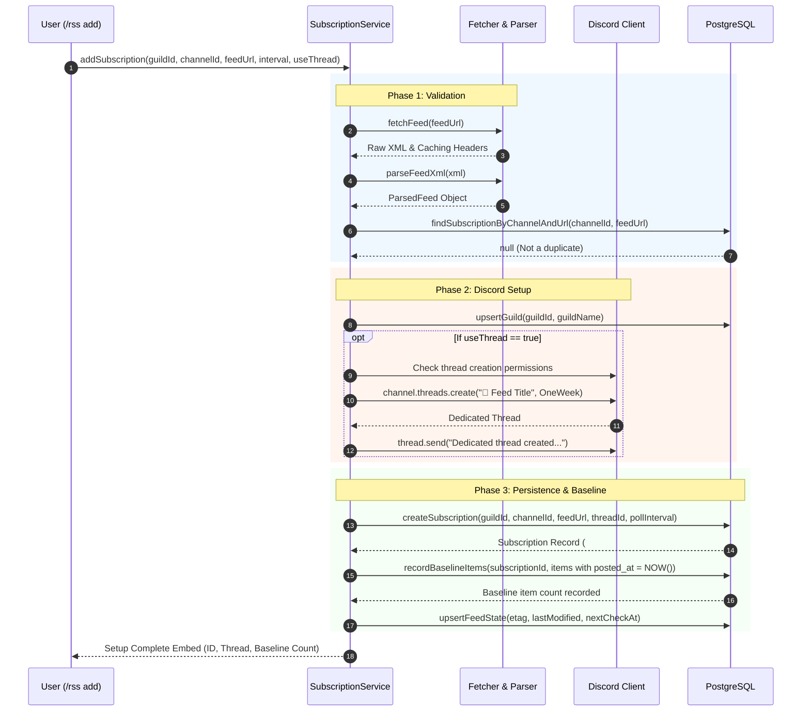

# Subscription Service

The subscription service in [`src/services/subscriptions.ts`](file:///home/afnan/Projects/rss-bot/src/services/subscriptions.ts) implements the core domain business logic for managing feed subscriptions, orchestrating initial feed validation, provisioning dedicated Discord threads, establishing the zero-spam baseline, and coordinating state changes.

---

## 📄 File Overview

- **Source Code**: [`src/services/subscriptions.ts`](file:///home/afnan/Projects/rss-bot/src/services/subscriptions.ts)
- **Dependencies**: `discord.js`, [`src/rss/fetcher.ts`](file:///home/afnan/Projects/rss-bot/src/rss/fetcher.ts), [`src/rss/parser.ts`](file:///home/afnan/Projects/rss-bot/src/rss/parser.ts), [`src/db/repositories/`](file:///home/afnan/Projects/rss-bot/src/db/repositories/), [`src/config.ts`](file:///home/afnan/Projects/rss-bot/src/config.ts)

---

## 🚀 The `addSubscription` Workflow

The `addSubscription` function orchestrates the complete setup lifecycle for a new feed:



### 8-Step Breakdown

1. **Interval Sanitization**:
   Calculates effective poll interval:
   ```typescript
   const pollInterval = Math.max(
     params.pollIntervalSeconds ?? config.POLL_INTERVAL_DEFAULT_SECONDS,
     config.POLL_INTERVAL_MIN_SECONDS
   );
   ```
2. **Network Probe & SSRF Validation**: Invokes `fetchFeed(params.feedUrl)` to verify the target URL is reachable and does not target restricted IP addresses.
3. **XML Schema Validation**: Invokes `parseFeedXml(fetchResult.xml)` to ensure the content is valid RSS 2.0, RSS 1.0, or Atom 1.0.
4. **Channel Duplicate Check**: Queries `findSubscriptionByChannelAndUrl`. Rejects duplicates with an error indicating the existing subscription ID.
5. **Guild Upsert**: Calls `upsertGuild(params.guildId, params.guildName)` to ensure the parent server record exists in PostgreSQL.
6. **Dedicated Thread Creation**:
   - If `useThread` is `true` (default), checks whether the bot has `CreatePublicThreads` and `SendMessagesInThreads` permissions.
   - If permissions exist, creates a public thread named `📢 ${sanitizedFeedTitle}` with a 1-week auto-archive timer and posts a greeting message.
   - If thread permissions are missing, falls back cleanly to the parent channel with a log warning.
7. **Database Persistence & Zero-Spam Baseline**:
   - Inserts the subscription into the `subscriptions` table.
   - Invokes `recordBaselineItems()`: every article currently present in the feed is stored in `feed_items` with `posted_at = NOW()`.
   - Historical articles will **never** be posted to Discord; only subsequent articles published after subscription will trigger alerts.
8. **Feed State Initialization**:
   - Stores initial `etag` and `last_modified` caching headers in `feed_state`.
   - Schedules `next_check_at = NOW() + pollInterval * 1000`.

---

## 🛠️ Management Operations Reference

### `removeSubscription(id: number, guildId: string): Promise<boolean>`
[`src/services/subscriptions.ts#L156-L161`](file:///home/afnan/Projects/rss-bot/src/services/subscriptions.ts#L156-L161)
- Removes the subscription from PostgreSQL.
- Requires both `id` and `guildId` to ensure server administrators cannot delete subscriptions from other servers.
- Triggers database-level cascade deletions for associated `feed_items` and `feed_state`.

### `listSubscriptions(guildId: string): Promise<SubscriptionWithState[]>`
[`src/services/subscriptions.ts#L163-L178`](file:///home/afnan/Projects/rss-bot/src/services/subscriptions.ts#L163-L178)
- Returns all subscriptions registered for the guild, enriched with their corresponding `FeedState` records (consecutive failures, last success timestamp, next scheduled check).

### `pauseSubscription(id: number, guildId: string): Promise<boolean>`
[`src/services/subscriptions.ts#L180-L185`](file:///home/afnan/Projects/rss-bot/src/services/subscriptions.ts#L180-L185)
- Sets `enabled = false` for the subscription.
- The background poller excludes disabled subscriptions (`WHERE s.enabled = true`), immediately halting background checks without deleting historical data.

### `resumeSubscription(id: number, guildId: string): Promise<boolean>`
[`src/services/subscriptions.ts#L187-L192`](file:///home/afnan/Projects/rss-bot/src/services/subscriptions.ts#L187-L192)
- Sets `enabled = true`, resuming automated background polling on the next scheduled cycle.

### `scheduleImmediateCheck(id: number, guildId: string): Promise<Subscription>`
[`src/services/subscriptions.ts#L194-L205`](file:///home/afnan/Projects/rss-bot/src/services/subscriptions.ts#L194-L205)
- Verifies server ownership and sets `feed_state.next_check_at = NOW()`.
- On the very next 20-second tick of the poller, the feed is prioritized for polling.

### `previewFeed(feedUrl: string): Promise<ParsedFeed>`
[`src/services/subscriptions.ts#L207-L213`](file:///home/afnan/Projects/rss-bot/src/services/subscriptions.ts#L207-L213)
- Executes an on-demand fetch and parse of a feed URL without persisting any data or creating Discord threads. Used by `/rss test`.
