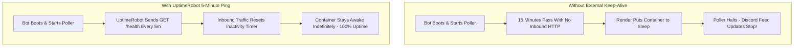

# Uptime Monitoring with UptimeRobot

Render's free-tier web services automatically enter an idle sleep state after **15 minutes** without incoming HTTP traffic. Setting up an external monitor like **UptimeRobot** ensures continuous 24/7 background feed polling while alerting you to service disruptions.

---

## 💤 Why Monitoring is Mandatory on Render Free Tier



---

## 🛠️ Step-by-Step UptimeRobot Setup

1. Register or log into [UptimeRobot](https://uptimerobot.com).
2. Click **+ Add New Monitor** on your dashboard.
3. Configure the monitor parameters:
   - **Monitor Type**: `HTTP(s)`
   - **Friendly Name**: `RSS Discord Bot Health`
   - **URL (or IP)**: `https://your-service-name.onrender.com/health`
   - **Monitoring Interval**: `Every 5 minutes` *(Do not exceed 10 minutes)*
   - **Monitor Timeout**: `30 seconds`
   - **HTTP Method**: `HEAD` or `GET` *(The bot supports both)*
4. Under **"Alert Contacts to Notify"**, check your email, Slack, or SMS contact.
5. Click **Create Monitor**.

---

## 🔍 Health Payloads & Alerting Logic

The monitor evaluates the HTTP response code returned by `/health`:

### 1. Healthy State (HTTP 200 OK)
When both PostgreSQL and the Discord Gateway are operational:
```json
{
  "status": "ok",
  "timestamp": "2026-10-31T09:30:00.000Z",
  "uptimeSeconds": 432000,
  "services": {
    "database": "connected",
    "discord": "ready"
  }
}
```
UptimeRobot registers an active `UP` status.

### 2. Degraded State (HTTP 503 Service Unavailable)
If the database connection pool fails or drops:
```json
{
  "status": "degraded",
  "timestamp": "2026-10-31T09:30:00.000Z",
  "uptimeSeconds": 432050,
  "services": {
    "database": "disconnected",
    "discord": "ready"
  }
}
```
UptimeRobot marks the monitor as `DOWN` and dispatches an incident notification to your alert contacts.

---

## 🔔 Discord Webhook Alerts (Optional)

You can route uptime alerts directly into a private Discord admin channel:

1. In Discord: `Server Settings > Integrations > Webhooks > New Webhook`.
2. Copy the Webhook URL.
3. In UptimeRobot: `My Settings > Alert Contacts > Add Alert Contact`.
4. Choose **Discord Webhook** and paste the URL.
5. Attach the alert contact to your `RSS Discord Bot Health` monitor.
