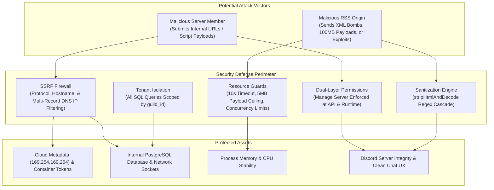

# Security & Threat Model

The RSS Discord Bot interacts with two untrusted environments:
1. **The Discord Public User Interface**: Users supply feed URLs, target channels, and configuration parameters.
2. **The Open Internet**: The bot performs outbound HTTP requests against external, untrusted web servers and parses third-party XML payloads.

This document details the threat model, attack vectors, and defense mechanisms implemented across the codebase.

---

## 🛡️ Threat Model Overview



---

## 🔒 Threat Vector 1: Server-Side Request Forgery (SSRF)

### Attack Scenarios:
- **Cloud Metadata Stealing**: Requesting `http://169.254.169.254/latest/meta-data/` to harvest cloud credentials or IAM role tokens.
- **Internal Subnet Scanning**: Requesting `http://10.0.0.5:8080` or `http://172.17.0.2:5432` to map internal cloud architecture.
- **Loopback Exploitation**: Querying `http://127.0.0.1:3000/` or local database ports.

### Implementation Defenses ([`src/rss/fetcher.ts`](file:///home/afnan/Projects/rss-bot/src/rss/fetcher.ts)):
1. **Strict Protocol Whitelist**: Rejects any scheme other than `http:` and `https:`. Blocks `file:`, `ftp:`, `gopher:`, `ldap:`.
2. **Explicit Hostname Blacklist**: Rejects hostnames equal to `"localhost"`, or ending with `".local"` or `".internal"`.
3. **Multi-Record DNS Resolution**:
   - Queries DNS for all A (IPv4) and AAAA (IPv6) records via `lookup(hostname, { all: true })`.
   - If *any* returned IP address belongs to a private, loopback, link-local, carrier-grade NAT, or reserved range, the entire request is rejected before any TCP socket connects.
4. **Comprehensive Subnet Blocklist**:
   - Blocks IPv4: `0.0.0.0/8`, `10.0.0.0/8`, `100.64.0.0/10`, `127.0.0.0/8`, `169.254.0.0/16`, `172.16.0.0/12`, `192.0.0.0/24`, `192.0.2.0/24`, `192.168.0.0/16`, `198.18.0.0/15`, `198.51.100.0/24`, `203.0.113.0/24`, `224.0.0.0/4`, `240.0.0.0/4`.
   - Blocks IPv6: `::1`, `::`, `fc00::/7` (ULA), `fe80::/10` (Link-local), `ff00::/8` (Multicast), and IPv4-mapped IPv6 (`::ffff:x.x.x.x`).

---

## 💣 Threat Vector 2: Denial of Service & Resource Exhaustion

### Attack Scenarios:
- **XML Entities / XML Bomb**: Billion laughs or quadratic blowup attacks designed to consume gigabytes of heap memory during parsing.
- **Slowloris Origin / Infinite Hang**: A malicious server accepts connections but drips bytes indefinitely, exhausting process sockets.
- **Oversized Payloads**: An origin server streams gigabytes of data to cause Out-of-Memory (OOM) crashes.

### Implementation Defenses:
1. **Fast-XML-Parser Hardening**: Attribute name prefixing and literal string preservation (`parseTagValue: false`) avoid arbitrary code or prototype pollution risks.
2. **Configurable Payload Size Guard & Streaming Abort**:
   Guards against memory exhaustion by checking `Content-Length` headers upfront and monitoring chunk accumulation in `response.body.getReader()`. If bytes exceed `MAX_FEED_SIZE_MB` (default: 15MB), the reader cancels the TCP stream immediately:
   ```typescript
   if (totalBytes > maxSizeBytes) {
     await reader.cancel();
     throw new Error(`Feed payload exceeds ${config.MAX_FEED_SIZE_MB}MB limit`);
   }
   ```
3. **HTTP Fetch Timeout**:
   Every fetch request is bounded by an `AbortController` set to `FETCH_TIMEOUT_MS` (default: 10,000ms).
4. **Concurrency Bounds**:
   `CONCURRENT_POLL_LIMIT` caps simultaneous origin fetches (default: 5), preventing connection starvation.

---

## 🧼 Threat Vector 3: Content Injection & XSS

### Attack Scenarios:
- Feeds containing `<script>` tags, inline styling, tracking beacons, or malformed HTML designed to disrupt Discord embed rendering or mislead users.

### Implementation Defenses ([`src/rss/parser.ts`](file:///home/afnan/Projects/rss-bot/src/rss/parser.ts#L28-L54)):
1. **Regex Sanitization Engine (`stripHtmlAndDecode`)**:
   - Strips `<style>` and `<script>` blocks and all interior content.
   - Converts `<br>` and closing block tags (`</p>`, `</div>`, `</li>`, `</h1>`–`</h6>`) into spaces to preserve natural text boundaries.
   - Strips all HTML tags (`<[^>]+>`).
   - Normalizes decimal, hex, and named HTML entities into plaintext equivalents.
2. **Image URL Validation**:
   Lead images are passed through `new URL()` to verify protocol is strictly `http:` or `https:`. JavaScript URIs (`javascript:...`) or data URIs are discarded.

---

## 🛡️ Threat Vector 4: Multi-Tenant Authorization & Isolation

### Attack Scenarios:
- An administrator in Server A attempts to delete, pause, or view feeds configured in Server B.
- An unprivileged user without server permissions modifies feed subscriptions.

### Implementation Defenses:
1. **Dual-Layer Permission Enforcement**:
   - Discord API level: `setDefaultMemberPermissions(PermissionFlagsBits.ManageGuild)` hides commands from unprivileged users.
   - Runtime level: `handleRssCommand` checks `interaction.memberPermissions` for `ManageGuild` or `Administrator`.
2. **Strict SQL Tenant Isolation**:
   - Subscription deletions require matching `id` and `guild_id`:
     ```sql
     DELETE FROM subscriptions WHERE id = ${id} AND guild_id = ${guildId};
     ```
   - It is mathematically impossible for an administrator to alter or delete another server's feeds.
